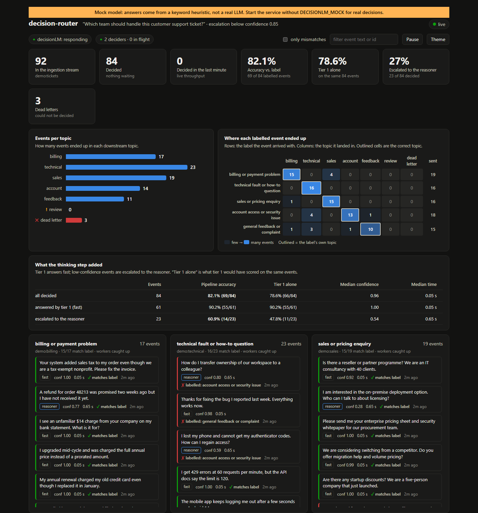

# decision-router

Route a stream of events by asking a local LLM to pick one option for each, and know how much to trust the answer.

Two components that work together, plus an evaluation of them, each with its own README, tests and config:

| Folder | What it is |
|---|---|
| [`service/`](service/README.md) (decisionLM) | A local HTTP service. Given a question and a fixed list of options it returns one option and a calibrated confidence: a fast logit-based tier 1 (about 0.1 s) that escalates to a slower thinking tier 2 when unsure. Needs a GPU. Measured accuracy and speed: [`service/RESULTS.md`](service/RESULTS.md). |
| [`eval/`](eval/README.md) | An evaluation on 320 public consumer complaints through the real stack, with a threshold and calibration refit and a comparison against Claude Haiku 5.5 and Sonnet 5.5. Findings: [`eval/README.md`](eval/README.md#findings). |
| [`pipeline/`](pipeline/README.md) | A Redis Streams consumer. Reads events from an ingestion stream, calls the service's `/api/decide`, and routes each event to a stream named for the chosen option, with retries, a dead-letter stream and crash recovery. Live demo in [`pipeline/demo`](pipeline/demo/README.md). |

```
events ──> Redis ingestion stream ──> pipeline/ (deciders) ──POST /api/decide──> service/ (decisionLM)
                                          ├──> one Redis stream per option ──> your consumers
                                          └──> live dashboard (http://127.0.0.1:5055, optional)
```

## Try it in five minutes (no GPU)

With only Docker installed:

```
git clone https://github.com/devaempran/decision-router && cd decision-router
docker compose --profile demo up --build      # or: make demo
```

Open http://127.0.0.1:5055. Redis, the service, the deciders and the dashboard start, and 92 labelled support tickets (with edge cases and
duplicates) flow through. The service runs its **mock backend**: a keyword heuristic that returns the real `/api/decide` response shape, so
the pipeline, escalation path, dead-letter stream and dashboard behave as they do with the model, but the answers are not LLM output
(the dashboard says so in a banner). Stop with `make down`.



Other paths: `make demo-mock` (native Python, Redis in Docker), `make demo-gpu` (the real Qwen3 model, needs the one-time setup in
[`service/README.md`](service/README.md)), `make test`. Run `make help` for the list.

## Quick start

You bring Redis, a config file and events. We run the rest.

1. **Redis**, reachable from this machine (`docker run -d -p 6379:6379 redis:latest`).
2. **One-time setup of the model service** (needs a GPU): see [`service/README.md`](service/README.md).
3. **A config**: copy [`pipeline/config/pipeline.toml`](pipeline/config/pipeline.toml) and fill in the question and the options:

   ```toml
   [decision]
   question = "Which team should handle this support ticket?"

   [[options]]
   name = "billing: invoices, charges, refunds"
   stream = "tickets:billing"

   [[options]]
   name = "technical: bugs, errors, outages"
   stream = "tickets:technical"
   ```

4. **Start it**: `python run.py start --config my.toml`. This creates the streams, launches decisionLM, runs the deciders, restarts
   anything that dies and reports progress. Ctrl+C stops it cleanly.
5. **Write events** to the `ingestion` stream (flat string fields, text in `payload`) and **read the results** from your option streams:

   ```
   XADD ingestion * id ticket-17 payload "I was charged twice for March"
   XREAD BLOCK 0 STREAMS tickets:billing $
   ```

`start` also serves a live dashboard at `http://127.0.0.1:5055` (turn it off with `[dashboard] enabled = false`).

Each result is the original event plus `label`, `confidence`, `source` and more. Events that cannot be decided go to `ingestion:dlq`
(and `python pipeline/run.py requeue` puts them back). Details, every setting and the failure behaviour: [`pipeline/README.md`](pipeline/README.md).

## Layout and development

Each component is self-contained: run its commands and tests from inside its own folder. `python run.py <command>` at this level is the same as `pipeline/run.py`.

```
service/    pytest   (the model is faked; no GPU needed)
pipeline/   pytest   (needs Redis; the end-to-end tests take about three minutes)
```

CI ([`.github/workflows/ci.yml`](.github/workflows/ci.yml)) runs both. [`LICENSE`](LICENSE) covers the whole repo.
